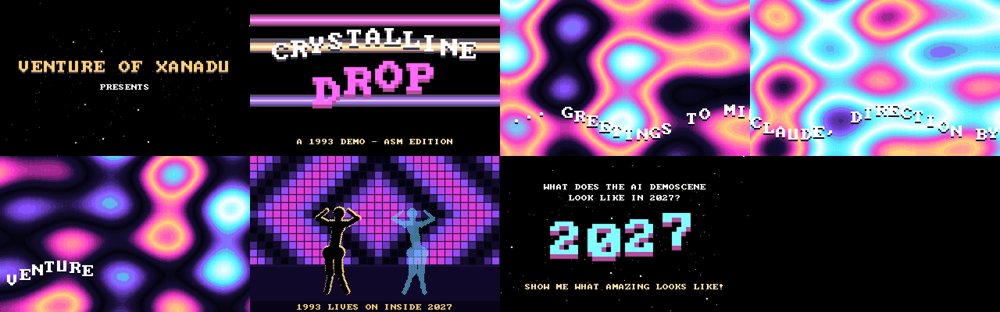

# Crystalline Drop — a 1993 demo (asm edition)

The real-hardware companion to [part 1](../1993-crystalline-drop/): a DOS `.COM`
in x86 real-mode assembler (386+), VGA Mode 13h, with Sound Blaster music. v0.2, about 78 s.



## Scenes (beat grid 171.60 BPM, same as part 1)

| beats | scene | what |
|---|---|---|
| 0–32 | INTRO | stateless 3D starfield, "VENTURE OF XANADU PRESENTS" |
| 32–64 | LOGO | four copper bars, sine-wobbled logo with drop shadow |
| 64–112 | PLASMA | 4-term plasma, crystal-night palette rotation, sine scroller with greetings |
| 112–176 | DANCER | LED wall (4 patterns, one per bar), gold-rim silhouette + mirrored cyan AI dancer, 4 arm moves |
| 176–224 | END | typed message, "SHOW ME WHAT AMAZING LOOKS LIKE!", big wobbling "2027" |

## Build and test

```sh
python3 tools/mkmusic.py                     # part 1's protracker.mp3 -> MUSIC.RAW (needs ffmpeg)
python3 tools/build.py                       # tables + nasm -> CDROP.COM
python3 tools/shoot.py /tmp/shots 6000 50000 # headless DOSBox frames -> PNG + contact sheet
```

Every frame is a pure function of time (`CDROP <ms>` renders exactly the realtime
frame), so the test rig checks the same code path as the demo, minus the timer,
mode switch and blit. Realtime was checked separately in DOSBox on a virtual X
display: right scene at 20/40/57 s, clean exit at the end.

## Music (v0.2)

- `MUSIC.RAW`: 8-bit unsigned mono PCM, 22222 Hz (Sound Blaster time constant 211),
  the first 224 beats of part 1's ProTracker edition. The lead-in is trimmed so
  sample 0 is beat 0, and it fades out over the last 2 beats.
- `src/sb.inc`: DSP reset/detect, `BLASTER` parsing (defaults A220 I7 D1), auto-init
  DMA over a 16 KiB ring that never crosses a 64 KiB page, and DSP block size 8 KiB.
  The IRQ handler only counts finished halves. The main loop refills them with DOS reads.
- The timer is zeroed right after the DSP starts, so the video clock and the music
  start together.
- Checked in DOSBox (SB16 emulation, SDL `disk` audio driver capturing the mixer):
  78.4 s of audio that cross-correlates with `MUSIC.RAW` throughout. There are no
  dropouts (a lost half would show as a 370 ms jump in lag). The emulator's audio
  clock drifts about 28 ms over the whole demo, which is under 2 frames.
- No card, an unsupported IRQ/DMA, or no `MUSIC.RAW` means it runs silent and says so on exit.

## Layout

| file | what |
|---|---|
| `CDROP.COM` | the prod (entry) |
| `MUSIC.RAW` | the music, generated by `tools/mkmusic.py` |
| `src/sb.inc` | Sound Blaster streaming |
| `src/cdrop.asm` | all of the code |
| `src/tables.inc` | generated: sine tables and palette (`tools/gentables.py`) |
| `tools/` | build, table generator, headless test rig |
| `shots/` | frames from the test rig |

## Not yet (v0.3+)

- Clock from the audio position (DMA count) instead of the PIT, so sync can never drift.
- Pick the best 224 beats of the track (today: the first 224, from beat 1).
- 16-bit SB16 output, and a small MOD player instead of PCM.
- Part 1's other scenes: voxel, glenz, twister, tunnel, fire greetings, rotozoom.
- Not checked: speed on a real 386/486 (DOSBox only).
